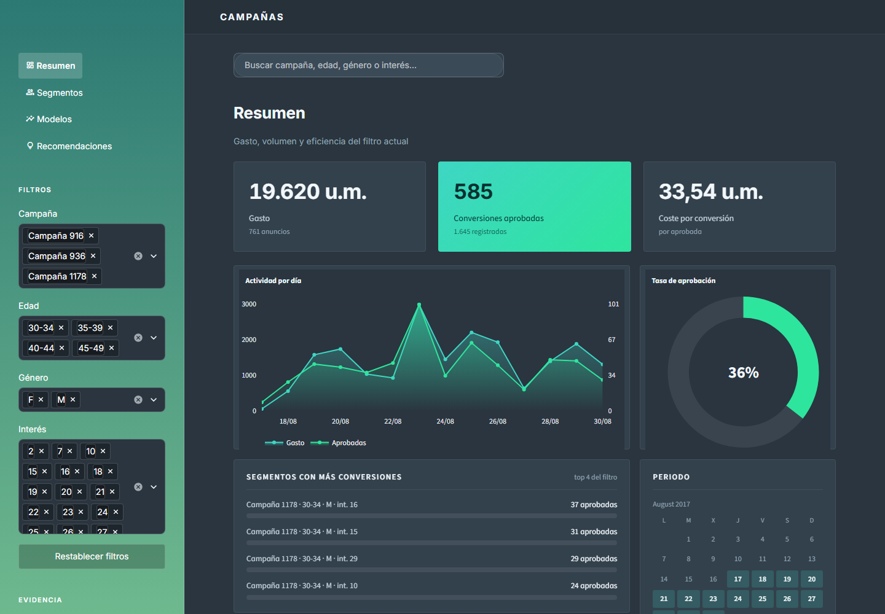

# Optimización de campañas publicitarias — Facebook Ad Campaign

Herramienta de análisis para un analista de marketing: qué campañas y segmentos
convierten con menos gasto, con qué error se pueden estimar conversiones de
anuncios nuevos y qué segmento merece una prueba de inversión.

Construida con **Streamlit · pandas · scikit-learn · Plotly**. Todo corre en local,
sin servicios externos, sin GPU y sin credenciales.



---

## Las tres preguntas y dónde se responden

| Pregunta | Vista del dashboard | Verificación |
|---|---|---|
| ¿Qué campañas y segmentos tienen menor gasto por conversión aprobada, y con cuánta evidencia? | **Eficiencia por segmento** | `verify.py` recalcula gasto y conversiones desde el CSV |
| ¿Con qué error estiman Random Forest y AdaBoost las conversiones de anuncios no vistos? | **Evaluación de modelos** | MAE/RMSE fuera de muestra + `pytest` |
| ¿Qué segmento merece una prueba de inversión y qué la respalda? | **Recomendaciones** | cada recomendación se traza a sus filas |

---

## Instalación desde una máquina limpia

Requisitos: **Python 3.12** (3.11–3.13 también sirven), ~250 MB de disco, sin GPU.

```powershell
# 1. Entorno
python -m venv .venv
.\.venv\Scripts\Activate.ps1        # Windows PowerShell
# source .venv/bin/activate          # Linux / macOS

# 2. Dependencias (versiones exactas en requirements.txt)
pip install -r requirements.txt
```

### 3. Consigue el dataset (obligatorio)

Fuente única: **<https://www.kaggle.com/datasets/madislemsalu/facebook-ad-campaign>**

1. Abre el enlace, inicia sesión y pulsa **Download** (obtienes un `.zip`).
2. Déjalo en:

```
campaign-optimizer/data/raw/
```

El proyecto **extrae el CSV del zip automáticamente** (el zip queda intacto) y lo
deja como `data/raw/facebook_ads.csv`. También puedes descomprimirlo a mano con
ese nombre exacto.

El archivo **no se versiona** (licencia y tamaño) y **nunca se modifica**: el
programa solo lo lee. Si falta, la app arranca y explica dónde colocarlo; no
inventa datos ni métricas.

#### Contrato de datos (verificado contra el archivo real)

El archivo real tiene **15 columnas**, no 11: tres intereses por anuncio y dos
fechas de reporte.

| Columna original | Campo interno | Tipo | Significado |
|---|---|---|---|
| `ad_id` | `ad_id` | entero | identificador del anuncio (agrupación) |
| `reporting_start` | `reporting_start` | fecha | inicio del corte (17/08/2017–30/08/2017) |
| `reporting_end` | `reporting_end` | fecha | fin del corte |
| `campaign_id` | `campaign_id` | entero | campaña; **unidad de la partición** |
| `fb_campaign_id` | `fb_campaign_id` | entero | identificador interno de Meta |
| `age` | `age` | texto | rango de edad (`30-34`, `35-39`, `40-44`, `45-49`) |
| `gender` | `gender` | texto | `M` / `F` |
| `interest1` | `interest1` | entero | interés principal del anuncio (**dimensión de segmento**) |
| `interest2` | `interest2` | entero | segundo interés (opcional, 431 valores: no se usa para segmentar) |
| `interest3` | `interest3` | entero | tercer interés (opcional, 168 valores) |
| `impressions` | `impressions` | entero | impresiones |
| `clicks` | `clicks` | entero | clics |
| `spent` | `spend` | decimal | gasto |
| `total_conversion` | `total_conversions` | entero | conversiones registradas |
| `approved_conversion` | `approved_conversions` | entero | conversiones aprobadas |

Una fila es **un anuncio con su segmento de audiencia y su corte de fechas**: no
es un usuario. Por eso los modelos predicen *conteos por registro*, no individuos.

`interest2` e `interest3` existen, pero se usan solo como contexto: con cientos de
valores distintos partirían cada segmento en celdas de uno o dos anuncios, sin
evidencia posible. La segmentación usa `interest1`.

### 4. Entrena

```powershell
python -m campaign_optimizer.train
```

Opciones: `--csv RUTA`, `--semilla N`, `--sin-ajuste`, `--sin-modelos-finales`.
Tarda ~20 s en este equipo.

Genera:

| Archivo | Contenido |
|---|---|
| `artifacts/predictions.csv` | predicciones **fuera de muestra** por registro |
| `artifacts/train_report.json` | métricas, variables, semilla, partición, versiones |
| `artifacts/data_quality.json` | informe de calidad y limpieza |
| `artifacts/models/*.joblib` | modelos finales (ajustados con todos los datos) |

Si el CSV cambia, el informe queda marcado como incompatible y el dashboard pide
volver a entrenar. No se mezclan resultados de versiones distintas.

### 5. Abre el dashboard

```powershell
streamlit run app.py
```

→ <http://localhost:8501>

---

## El archivo descargado tiene un bloque corrupto (importante)

Al inspeccionar el CSV antes de fijar el esquema apareció algo que condiciona
todos los resultados: **382 de las 1.143 filas tienen las columnas desplazadas
dos posiciones a la izquierda**. Se ve en el texto original: la edad aparece en
`campaign_id`, el género en `fb_campaign_id`, el interés 1 en `age`… y las dos
últimas columnas (`total_conversion`, `approved_conversion`) quedan vacías.

Consecuencia: de esas filas **se pierden `campaign_id` y `fb_campaign_id`**, así
que su gasto y sus conversiones no son atribuibles a ninguna campaña. El proyecto
las detecta por dominio de valores (campaña numérica + edad tipo `30-34` + género
`M`/`F`; se exige más de una violación) y las **excluye del análisis, no del
archivo**, con su propio contador en `data_quality.json`.

| | Filas |
|---|---|
| Registros en el CSV | 1.143 |
| Desalineadas (excluidas, sin campaña atribuible) | **382** |
| **Válidas para el análisis** | **761** |

Reparto de las 761 válidas: campaña **936** 464, campaña **1178** 243, campaña **916** 54.

> Si vuelves a descargar el dataset y obtienes un archivo sin ese bloque, ejecuta
> `python -m campaign_optimizer.train` y todo se recalcula: el dashboard detecta
> la nueva huella y no mezcla resultados. El código no depende de que el archivo
> esté corrupto.

Otras decisiones de limpieza, todas contadas en `artifacts/data_quality.json`:

| Hallazgo | Filas | Decisión |
|---|---|---|
| Desalineadas | 382 | excluidas (sin campaña), documentadas |
| Duplicados exactos | 0 | — |
| Valores negativos | 0 | — |
| Aprobadas > totales | 0 | — |
| Conversiones con cero clics | **200** | **se conservan marcadas**: pueden ser view-through; borrarlas eliminaría gasto real |
| Nulos en conversiones | 382 (los mismos desalineados) | excluidos |
| Cero impresiones | 0 | el CTR sería «No calculable» |

---

## Resultados reales

Ejecutado sobre las 761 filas válidas: semilla 42, partición *leave-one-campaign-out*,
artefactos en `artifacts/`.

### Totales del conjunto

Gasto **19.620,24 u.m.** · impresiones **78.513.588** · clics **11.674** ·
conversiones **1.645** (aprobadas **585**) · CTR **0,015 %** · CPC **1,68** ·
gasto por conversión aprobada **33,54**.

| Campaña | Anuncios | Gasto | Impresiones | Clics | Conv. totales | Aprobadas | CTR | Gasto/conv. aprobada |
|---|---:|---:|---:|---:|---:|---:|---:|---:|
| 916 | 54 | 149,71 | 482.925 | 113 | 58 | 24 | 0,023 % | **6,24** |
| 936 | 464 | 2.893,37 | 8.128.187 | 1.984 | 537 | 183 | 0,024 % | 15,81 |
| 1178 | 243 | 16.577,16 | 69.902.476 | 9.577 | 1.050 | 378 | 0,014 % | **43,85** |

La campaña 916 es **7 veces más eficiente** que la 1178 (6,24 vs 43,85 por
conversión aprobada) con 54 anuncios frente a 243. Eso no significa «mover todo a
916»: son campañas distintas, con objetivos y audiencias distintas (ver limitaciones).

### Error fuera de muestra (761 registros por modelo y objetivo)

| Objetivo | Modelo | n | MAE | RMSE | R² |
|---|---|---:|---:|---:|---:|
| Conversiones aprobadas | **Random Forest** | 761 | **0,772** | 1,619 | 0,043 |
| Conversiones aprobadas | AdaBoost | 761 | 0,855 | 1,705 | −0,061 |
| Conversiones aprobadas | Referencia (media) | 761 | 1,102 | 1,856 | −0,258 |
| Conversiones totales | **Random Forest** | 761 | **1,113** | 3,883 | 0,085 |
| Conversiones totales | AdaBoost | 761 | 1,557 | 4,027 | 0,016 |
| Conversiones totales | Referencia (media) | 761 | 2,711 | 4,652 | −0,313 |

**Lectura honesta:** los dos modelos baten a la referencia en los dos objetivos.
Random Forest reduce el MAE un **30 %** en aprobadas (0,772 vs 1,102) y un **59 %**
en totales (1,113 vs 2,711). Pero el **R² es ≈ 0 o negativo**: el modelo acierta
más que la media, y aun así **no explica la varianza**. No es un modelo que
«entienda» las conversiones; es un corrector de la media. Eso se dice en la
interfaz y aquí, no se maquilla.

El error no se reparte igual entre campañas (esta es la incertidumbre real con 3
grupos):

| Campaña evaluada | n | RF (aprobadas) | AdaBoost | Referencia | RF (totales) | AdaBoost | Referencia |
|---|---:|---:|---:|---:|---:|---:|---:|
| 916 | 54 | **0,468** | 0,518 | 0,533 | **0,191** | 0,664 | 1,171 |
| 936 | 464 | **0,510** | 0,607 | 0,991 | **0,243** | 0,880 | 2,585 |
| 1178 | 243 | **1,339** | 1,403 | 1,439 | **2,978** | 3,050 | 3,294 |

La campaña 1178 —la más grande y la más cara— es donde todo falla más: MAE 1,339
en aprobadas frente a 0,468/0,510 en las otras. Un error medio de 0,77 esconde
una campaña donde el modelo apenas mejora a la media. Cualquier uso operativo
tiene que mirar el desglose, no el promedio.

Hiperparámetros elegidos por validación agrupada interna (solo con campañas de
entrenamiento): Random Forest `max_depth=12, min_samples_leaf=3` en totales y
`max_depth=None, min_samples_leaf=1` en aprobadas; AdaBoost `100–200` estimadores
con `learning_rate` 0,5–1,0 según la vuelta. El detalle por vuelta queda en
`train_report.json`.

### Lectura por campaña (resultado independiente)

- **916**: 54 anuncios, la más eficiente con diferencia (6,24 por aprobada), pero
  es también la de menor volumen: 24 conversiones aprobadas. Evidencia moderada.
- **936**: el caballo de batalla (464 anuncios, 183 aprobadas) a 15,81.
- **1178**: 243 anuncios y 378 aprobadas, pero a 43,85 por conversión aprobada:
  el gasto crece mucho más rápido que las conversiones.

---

## Cómo se calcula cada cosa

Todos los indicadores se calculan **sobre sumas del conjunto filtrado**, nunca
promediando ratios fila a fila (eso daría cifras que no cuadran con los totales):

| Indicador | Fórmula | Si el denominador es 0 |
|---|---|---|
| CTR (%) | `100 × Σ clics / Σ impresiones` | «No calculable», totales visibles |
| CPC | `Σ gasto / Σ clics` | «No calculable» |
| Gasto por conversión aprobada | `Σ gasto / Σ conversiones aprobadas` | «No calculable» |

**Moneda:** la fuente no la documenta. Los importes van en **unidades monetarias
de la fuente (u.m.)**; no se afirma que sean USD ni EUR.

Una sola función (`analytics.totals`, `analytics.segment_summary`) alimenta las
tarjetas, las tablas y los gráficos, de modo que los tres muestran el mismo
número por construcción.

### Identidad visual

El panel sigue la **referencia de dashboard de administración** aportada por el
usuario: sidebar con degradado teal→verde, lienzo pizarra, tarjetas KPI (una en
degradado cian→verde), áreas con relleno degradado, dona, barras de progreso y
calendario del periodo.

| Elemento | Implementación |
|---|---|
| Sidebar | `linear-gradient(180deg, #2C7873, #6FB98F)` con navegación de icono + etiqueta |
| Lienzo y paneles | `#2A353F` y `#33414D`, radios de 4px y hairline blanco al 8 % |
| KPI | Tres tarjetas; la central con `linear-gradient(135deg, #3ED6C4, #2EE59D)` y texto oscuro |
| Áreas | Plotly 7 `fillgradient` vertical (cian y verde), sin imágenes |
| Dona | `go.Pie` con agujero 0.72 y el porcentaje como anotación central |
| Barras | Relleno degradado sobre pista translúcida |
| Calendario | Rejilla del mes del periodo con los días con datos resaltados |

Componentes en `ui.py` (`kpis`, `panel`, `bars`, `month_grid`, `table`) y tema en
`theme.py`. Sin `box-shadow`: la jerarquía viene del color del panel y del hairline.

> Esta disposición es propia del proyecto y se aparta del layout de `raycast/DESIGN.md`
> (que sigue siendo la referencia de los tokens de superficie y del sistema de
> componentes de la biblioteca). La paleta base es la gama indicada por el usuario:
> `#021C1E`, `#004445`, `#2C7873`, `#6FB98F`.
### Formato y jerarquía de la interfaz

- **Un solo formato numérico en toda la pantalla**, en convención española: miles
  con punto, decimales con coma y espacio antes del `%`. `19.620 u.m.`,
  `33,54 u.m.`, `0,015 %`, `78.513.588`. Los gráficos usan los mismos separadores
  (`separators=",."` en Plotly), no solo las tarjetas.
- **El resultado primero**: arriba y en todas las vistas, gasto, conversiones
  aprobadas y coste por conversión aprobada. Debajo, una línea corta de contexto
  («761 de 1.143 registros analizados · 3 campañas · 761 anuncios») con el detalle
  de las 382 filas excluidas en un desplegable, no en un aviso que ocupa media
  pantalla.
- **Indicadores de apoyo después**: impresiones, clics, CTR, CPC, anuncios y
  conversiones totales viven en el resumen, detrás del resultado principal.

---

## Modelado: qué se estima y cómo se evalúa

**Momento de la estimación:** una vez conocidos *gasto, impresiones y clics* del
anuncio (el escenario de un analista que revisa el día cerrado). Decisión tomada
**antes** de elegir variables.

- **Entradas:** `spend`, `impressions`, `clicks`, `age`, `gender`, `interest1`.
- **Excluidas:** los dos objetivos, sus derivados (CTR, CPC, coste por conversión)
  y los identificadores (`ad_id`, `fb_campaign_id`, `campaign_id`).
- **Objetivos:** conversiones totales y conversiones aprobadas, por separado.
- **Modelos:** `RandomForestRegressor`, `AdaBoostRegressor` y `DummyRegressor`
  (referencia: la media) sobre **las mismas particiones**.

**Partición: leave-one-campaign-out.** Con 3 campañas, cada una se reserva entera
una vez y se predice con un modelo que nunca la vio. Es la pregunta útil («¿cómo
rendirá en campañas nuevas?») y evita que el mismo anuncio esté en train y test.
El precio es que el error medio es la media de tres números: por eso el desglose
por campaña es parte del resultado, no un anexo.

**Ajuste de hiperparámetros** con `GroupKFold` **solo dentro del entrenamiento** de
cada vuelta. `StandardScaler` y `OneHotEncoder` se ajustan dentro del pipeline.

**Métricas:** MAE y RMSE en conversiones por registro. Si la referencia gana, el
dashboard lo dice; aquí no ocurre en ninguna de las seis comparaciones.

---

## Recomendaciones: umbral de evidencia

Un segmento se propone solo si cumple **las cuatro** condiciones (configurables en
la barra lateral y en `config.py`):

| Condición | Valor inicial | Por qué ese valor (distribución observada) |
|---|---|---|
| Conversiones aprobadas | ≥ 1 | 72 de 251 segmentos no tienen ninguna: sin conversiones no hay eficiencia |
| Anuncios distintos | ≥ 3 | mediana real = 2 anuncios/segmento; 105 de 251 (42 %) llegan a 3 |
| Cuota de gasto en su campaña | ≥ 2 % | descarta segmentos de gasto irrelevante (96 segmentos caen aquí) |
| Mejora vs. resto de su campaña | ≥ 20 % | exige diferencia material; 13 segmentos caen por debajo |

Con estos valores, **251 segmentos** (campaña × edad × género × interés1) se
reducen a **4 candidatos** (1,6 %). El resto se descarta con motivo explícito,
que la vista muestra en una tabla.

### Las 4 recomendaciones obtenidas

| Campaña | Segmento | Gasto | Aprobadas | Anuncios | Coste/aprobada | Resto de campaña | Mejora |
|---|---|---:|---:|---:|---:|---:|---:|
| 1178 | 30-34 · M · interés 16 | 542,11 | 37 | 4 | **14,65** | 47,02 | **−69 %** |
| 1178 | 30-34 · M · interés 29 | 485,54 | 29 | 5 | **16,74** | 46,11 | −64 % |
| 1178 | 30-34 · M · interés 10 | 624,69 | 24 | 5 | **26,03** | 45,06 | −42 % |
| 1178 | 30-34 · M · interés 15 | 933,10 | 31 | 5 | **30,10** | 45,08 | −33 % |

Las cuatro caen en la campaña **1178** y en el mismo perfil (30-34, masculino), que
es justo la campaña más ineficiente en conjunto: hay un segmento que funciona
mucho mejor que su media. Cada tarjeta del dashboard permite recalcular el número
desde sus filas (gasto, anuncios y conversiones) y compararlo con el resto de la
campaña, no con otra campaña.

---

## La prueba A/B: qué se prueba exactamente

La app **no** usa la diferencia histórica como mejora exigida. Ese 69 % es una
comparación *transversal* (el segmento frente al resto de su campaña, en el
pasado); la prueba mide un efecto *longitudinal* (qué cambia dentro del segmento
al subir el presupuesto). Son cosas distintas y mezclarlas sería un error de diseño.

**Pregunta que se prueba.** ¿Un **25 % más de presupuesto** en ese segmento produce
más conversiones aprobadas, manteniendo el coste por conversión aprobada por debajo
del **techo propuesto de 19,05 u.m.** (el observado, 14,65, más un 30 % de margen)?

**Diseño.** Con 4 anuncios en el segmento, sortearlos dejaría brazos de 1-2 y
confundiría presupuesto con antigüedad del creativo. Por eso el plan calculado
propone **switchback por bloques temporales**: los mismos anuncios, con y sin
+25 % de presupuesto, alternando bloques y ambos brazos en paralelo. Con 8 o más
anuncios comparables el módulo cambia solo a **aleatorización por anuncio,
estratificada por gasto y antigüedad** (`experiment.py`). En ambos casos el
reparto de exposición es 50/50 y los días de calendario ya lo incorporan.

**Regla de decisión, fijada antes de empezar.** Métrica primaria: conversiones
aprobadas por brazo. Se adopta solo si el intervalo de confianza al 95 % del
efecto queda por encima de 0 **y** el coste por conversión no supera el techo
propuesto de 19,05 u.m.; se descarta si el coste lo supera aunque las conversiones
suban.

**Muestra calculada** (Poisson, dos brazos, α = 0,05, potencia 80 %), con la tasa
observada de 37 aprobadas en 14 días ≈ 2,64 al día y un reparto de exposición
50/50 entre brazos. La tasa se usa completa y el calendario se redondea **hacia
arriba**, porque son días completos que hay que planificar: 95,35 días por brazo
× 2 = 190,70 → 191 días de calendario.

| Mejora a detectar | Aprobadas por brazo | Días de exposición por brazo | Días de calendario necesarios | Presupuesto estimado de la prueba |
|---|---:|---:|---:|---:|
| **25 %** | 252 | 95,35 | **191** | 8.307 u.m. |
| 40 % | 99 | 37,46 | 75 | 3.264 u.m. |
| 50 % | 63 | 23,84 | 48 | 2.077 u.m. |
| 75 % | 28 | 10,59 | **22** | 923 u.m. |

**Qué es el presupuesto, y qué no.** Es lo que cuesta **ejecutar** la prueba:
días de exposición × gasto diario del segmento (38,72), con el control a gasto
actual y la variante al +25 %; de ahí el factor 2,25. **No** es una valoración de
las conversiones a coste histórico (252 × 2 × 14,65 ≈ 7.384 u.m. sería justo eso,
y no es la pregunta): el coste por conversión de la variante es una de las
incógnitas que el experimento intenta medir.

**Lo que no se hace.** El efecto mínimo a detectar queda como decisión de negocio
pendiente; la app lo deja elegir y parte del 25 %. Con los supuestos actuales, el
**50 % es el menor efecto de la tabla detectable en 60 días**, y el 75 % también
cabe. Pero elegir un efecto mayor solo para acortar la prueba podría dejar sin
detectar una mejora del 25 % que sí justifique la inversión.

**Pregunta que debe responder negocio.** Si invertir un 25 % más produjera un 25 %
más de conversiones y mantuviera el coste por conversión, ¿adoptaríamos el cambio?
Si la respuesta es sí, el escenario del 25 % merece seguir visible aunque supere
los 60 días.

**Techo de coste: propuesto, no decidido.** El 19,05 u.m. sale de añadir un 30 %
al coste histórico observado (14,65). Convertirlo en límite operativo es una
decisión de negocio previa al lanzamiento; la app lo etiqueta como propuesta.

**Supuestos y límites de la estimación.** Los días de calendario son preliminares:
no incorporan la variación entre días ni el retardo de registro de conversiones.
La ventana de medición debe extenderse hasta que se registre la última conversión
atribuible, y ese criterio de cierre se fija antes de lanzar. La estimación supone
Poisson, dos brazos iguales y contraste bilateral.

---

## Los cuatro requisitos de negocio

| Requisito | Cómo se entrega | Dónde |
|---|---|---|
| **ROI** | Se usa gasto por conversión aprobada como indicador de eficiencia. Se declara que el ROI financiero exige ingresos o margen atribuible, que el archivo no contiene: un ROI calculado aquí sería inventado. | vista Recomendaciones |
| **A/B testing** | Propuesta experimental derivada del hallazgo real (segmento 30-34 · M · interés 16), con la pregunta correcta, aleatorización sin confundir presupuesto con antigüedad, techo de coste fijado antes y tamaño de muestra calculado. Detalle en la sección siguiente. | vista Recomendaciones |
| **Atribución** | Distribución descriptiva de conversiones por campaña (4,1 % / 31,3 % / 64,6 % de las aprobadas) y explicación de que primer/último contacto y multicanal requieren recorridos de usuario que el archivo no tiene. | vista Recomendaciones |
| **Comparación de canales** | Implementada **entre campañas dentro de Facebook**; Facebook es el único canal del archivo y así se rotula en títulos y gráficos. | vistas Resumen y Recomendaciones |

---

## Estructura

```
campaign-optimizer/
├── app.py                       entrypoint de Streamlit
├── campaign_optimizer/
│   ├── config.py                rutas, semilla, contrato de columnas, umbrales
│   ├── data.py                  lectura, validación, limpieza, informe de calidad
│   ├── analytics.py             métricas y recomendaciones (fuente única)
│   ├── modeling.py              variables, partición, entrenamiento, artefactos
│   ├── train.py                 CLI de entrenamiento
│   ├── experiment.py            diseño de la prueba A/B (muestra, techo, unidades)
│   ├── theme.py                 ventana macOS: tokens, CSS y plantilla Plotly
│   ├── ui.py                    componentes HTML (grupos, filas, tablas, badges)
│   ├── verify.py                verificación de criterios de aceptación
│   └── app.py                   interfaz de 4 vistas
├── tests/                       29 tests (datos, analítica, modelado, experimento)
├── data/raw/                    el CSV original (no versionado)
├── artifacts/                   resultados del entrenamiento (no versionados)
├── DESIGN.md                    sistema de diseño adoptado (awesome-design-md)
├── requirements.txt             versiones exactas
├── Dockerfile                   despliegue en contenedor
└── pytest.ini
```

---

## Verificación ejecutada

```powershell
python -m pytest                    # 29 passed
python -m campaign_optimizer.verify # 12/12 criterios
```

Salida real de `verify.py` con este archivo:

```
[PASS] CSV cargado y validado — 761 filas válidas de 1143, huella c70e7203b4dc25e9
[PASS] Totales y gasto/conversión por campaña — campaña 916: ok; campaña 936: ok; campaña 1178: ok
[PASS] Filtro vacío produce estado comprensible — totales a cero y ratios 'No calculable'
[PASS] Segmentos con gasto y cero conversiones aprobadas — 72 segmento(s) afectados
[PASS] Los resultados corresponden a este CSV — informe c70e7203b4dc25e9 vs datos c70e7203b4dc25e9
[PASS] 4 ajustes pedidos + 2 referencias presentes — 6 combinaciones
[PASS] Predicciones fuera de muestra completas (conversiones_totales) — 761 de 761
[PASS] Predicciones fuera de muestra completas (conversiones_aprobadas) — 761 de 761
[PASS] Sin fuga: cada predicción es de una campaña no vista
[PASS] Cada recomendación se traza a gasto, volumen y conversiones — 4 recomendación(es)
[PASS] Plan A/B calculado desde las cifras del segmento — 252 aprobadas/brazo, 191 días de calendario, techo 19.05
[PASS] Partición registrada es la prometida — leave-one-campaign-out
```

`verify.py` recalcula los totales **con pandas puro sobre el CSV** y el mapeo de
columnas, sin usar `analytics`: si las dos vías discrepasen, fallaría.

Además se renderizaron las cuatro vistas de forma programática (`streamlit.testing`):
0 excepciones, 12 tarjetas, 9 tablas y 8 gráficos, con el aviso de «15 segmentos
con cero conversiones» visible en la vista de eficiencia. También se comprobó el
estado sin registros: campaña 916 + interés 2 (que solo existe en la 1178) muestra
«Los filtros no devuelven ningún registro» y ninguna tarjeta.

La interfaz se revisó además en un **navegador real** (Chromium vía Playwright) a
1440 px y 420 px: pestañas en píldora, chips legibles, iconos correctos y el botón
«» de apertura de filtros presente y funcional en móvil. Las capturas de
`docs/img/` salen de esa verificación.

---

## Despliegue

**Estado actual: no desplegado.** No hay destino ni cuenta autorizada; estos son
los pasos exactos.

### Opción A — Streamlit Community Cloud

1. Sube el repositorio a GitHub (`.gitignore` ya excluye `data/raw/` y `artifacts/`).
2. <https://share.streamlit.io> → **New app** → repo, rama `main`, archivo `app.py`.
3. **El dataset no está en el repo**: SCloud no permite montar volúmenes. Para una
   demo pública hay dos caminos: (a) Docker/servidor propio, o (b) versionar el CSV
   solo si la licencia de la fuente lo permite y con atribución.
4. Verifica la URL: `/` debe mostrar las 4 pestañas y la pestaña de modelos el aviso
   de «resultados de otra versión» si no se ejecutó el entrenamiento en el servidor.

### Opción B — Docker (recomendada para datos reales)

```powershell
docker build -t campaign-optimizer .
docker run --rm -p 8501:8501 `
  -v "${PWD}/data/raw:/app/data/raw:ro" `
  -v "${PWD}/artifacts:/app/artifacts" `
  campaign-optimizer
```

→ <http://localhost:8501>. Incluye `HEALTHCHECK` contra `/_stcore/health`.

### Opción C — servidor propio

```bash
streamlit run app.py --server.port 8501 --server.address 0.0.0.0
```

Sin autenticación por defecto: no lo expongas a Internet sin añadirla.

---

## Limitaciones

- **382 de 1.143 filas corruptas** en el archivo descargado: el análisis usa 761.
  Es la limitación más importante y está cuantificada arriba.
- **Tres campañas.** La partición por campañas es honesta, pero el error medio es
  la media de tres números y la campaña 1178 concentra el error.
- **R² ≈ 0.** Los modelos baten a la media en error absoluto, no explican la
  varianza. Sirven para estimar, no para entender el mecanismo.
- **Conversiones sin clics (200 filas).** Se conservan marcadas: pueden ser
  view-through; borrarlas eliminaría gasto real.
- **Sin ingresos.** No hay ROI financiero posible, solo eficiencia de gasto.
- **Sin recorridos.** No hay atribución por contacto ni comparación entre canales.
- **Asociación, no causalidad.** Que un segmento tenga menor coste histórico no
  demuestra que aumentar su presupuesto mantenga la eficiencia (rendimientos
  decrecientes, saturación de audiencia).
